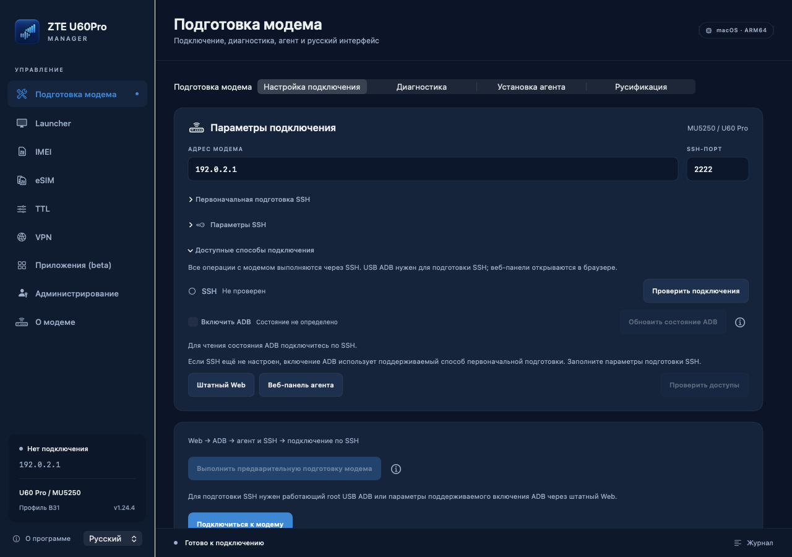
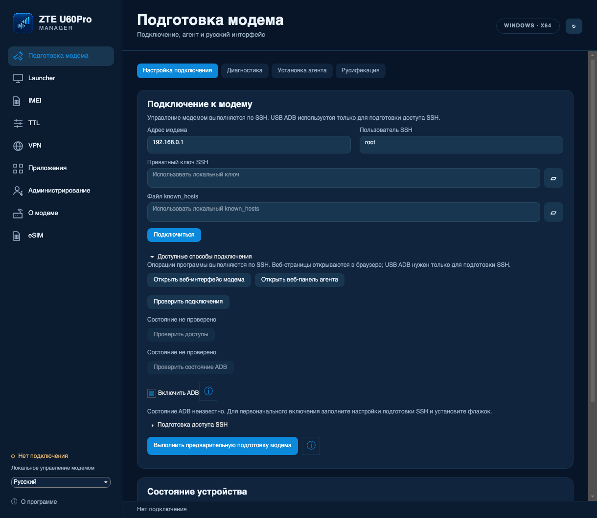
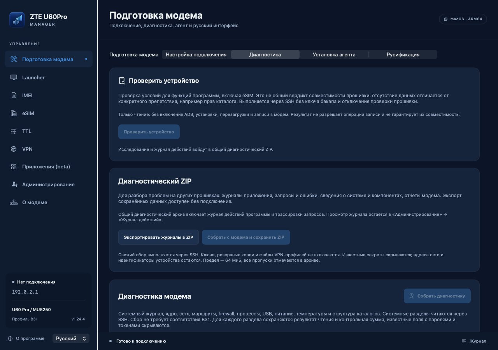
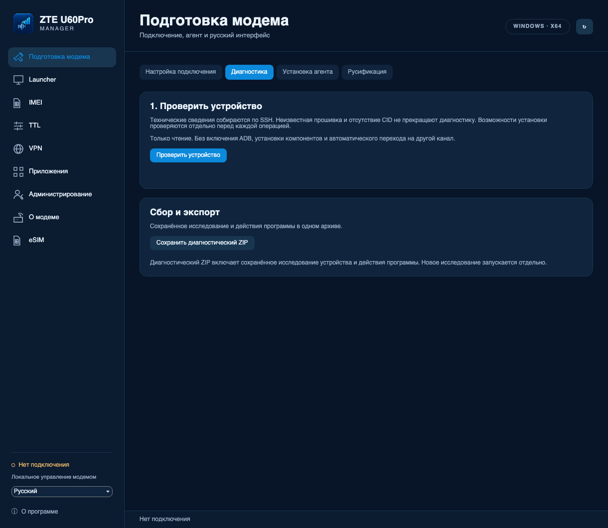
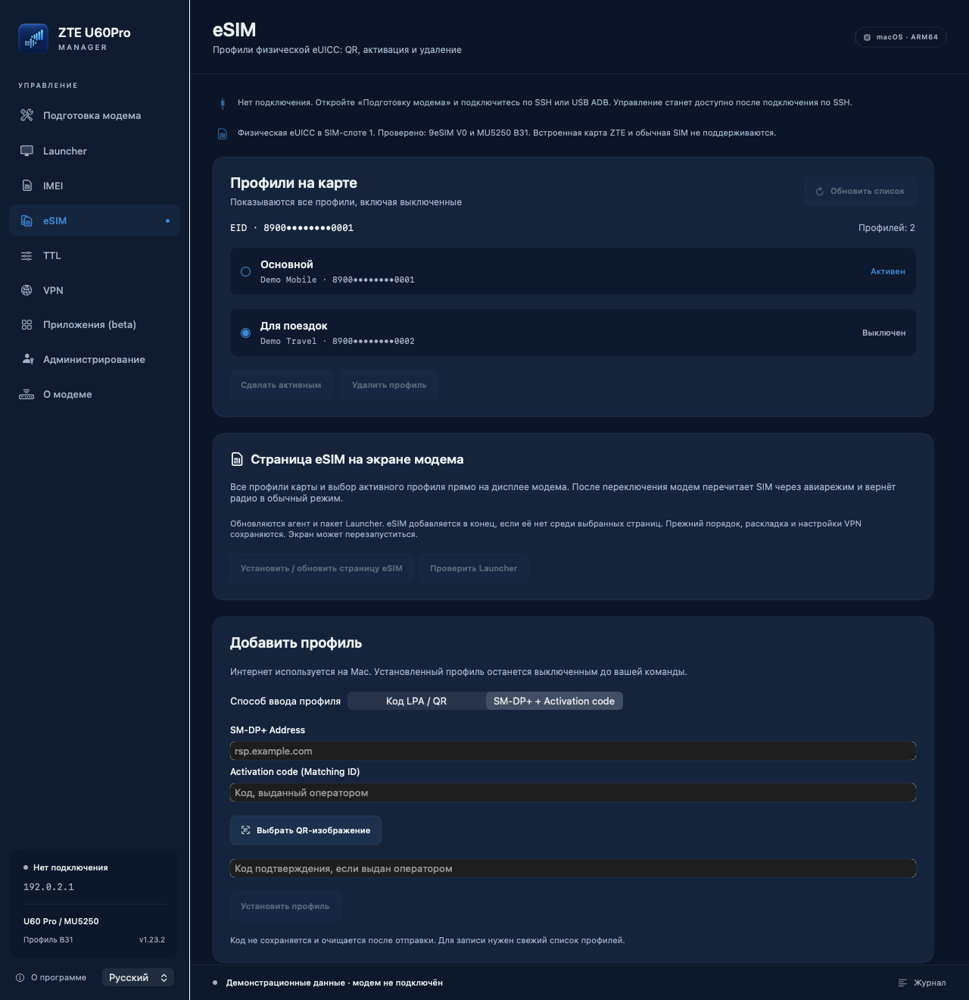
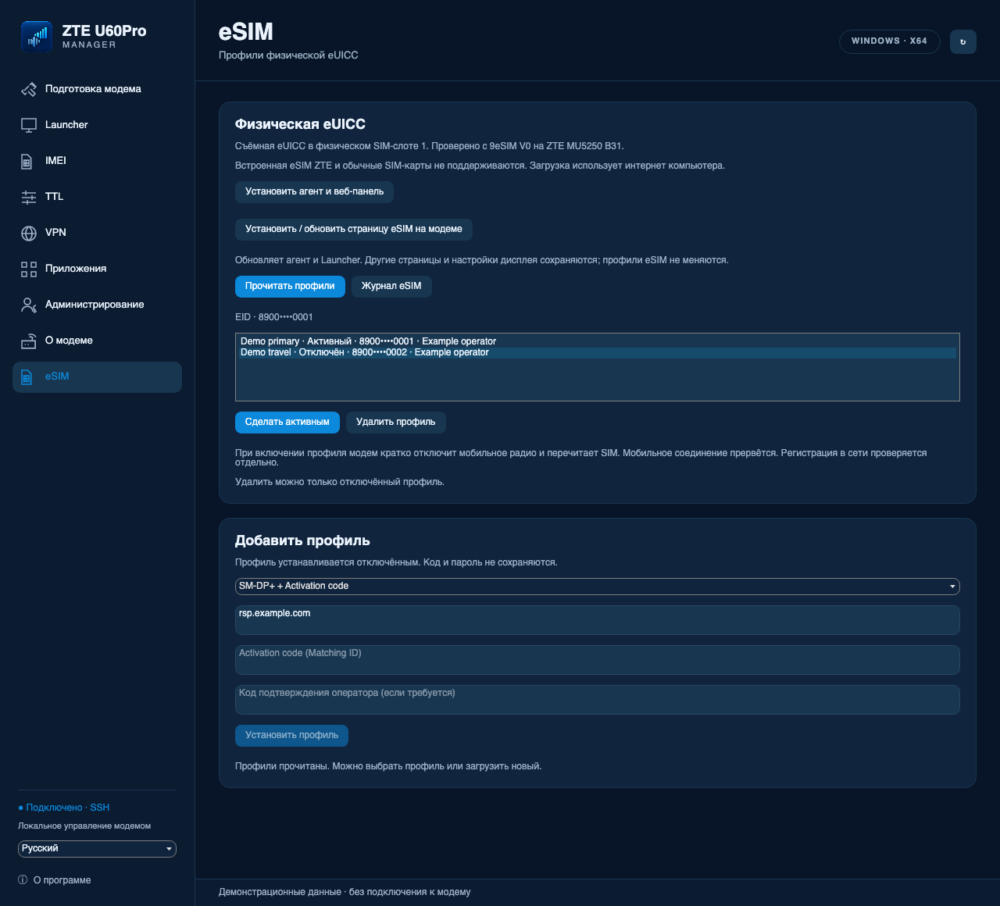
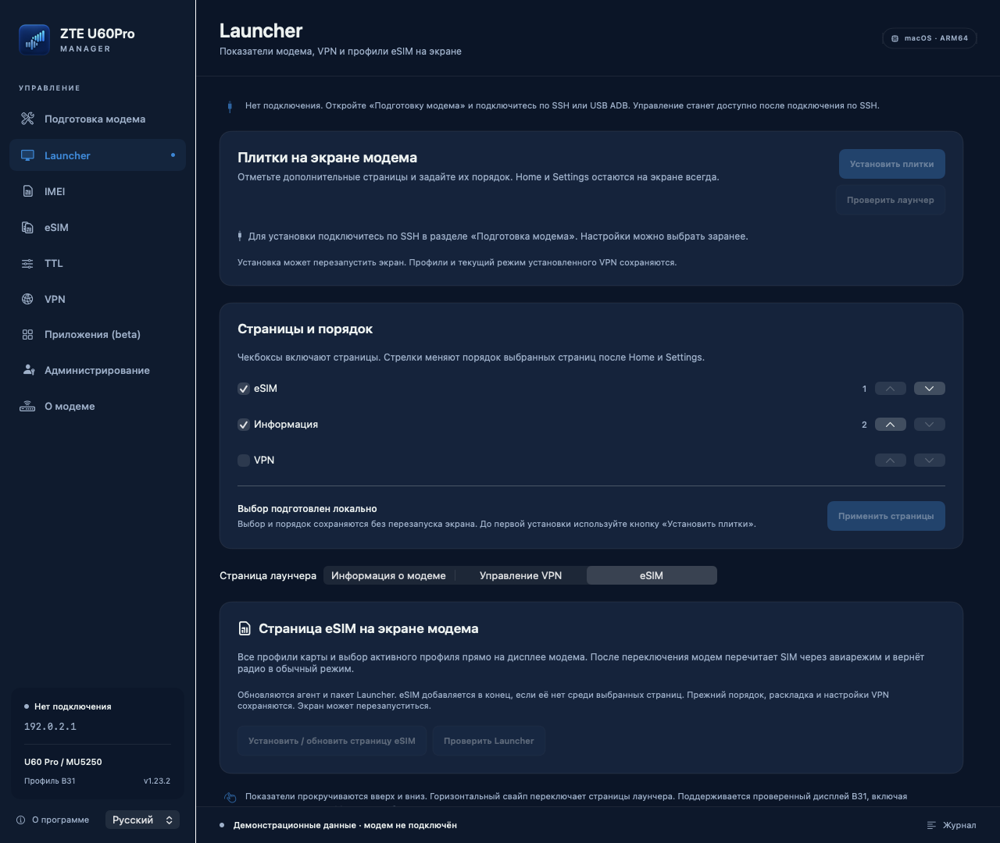
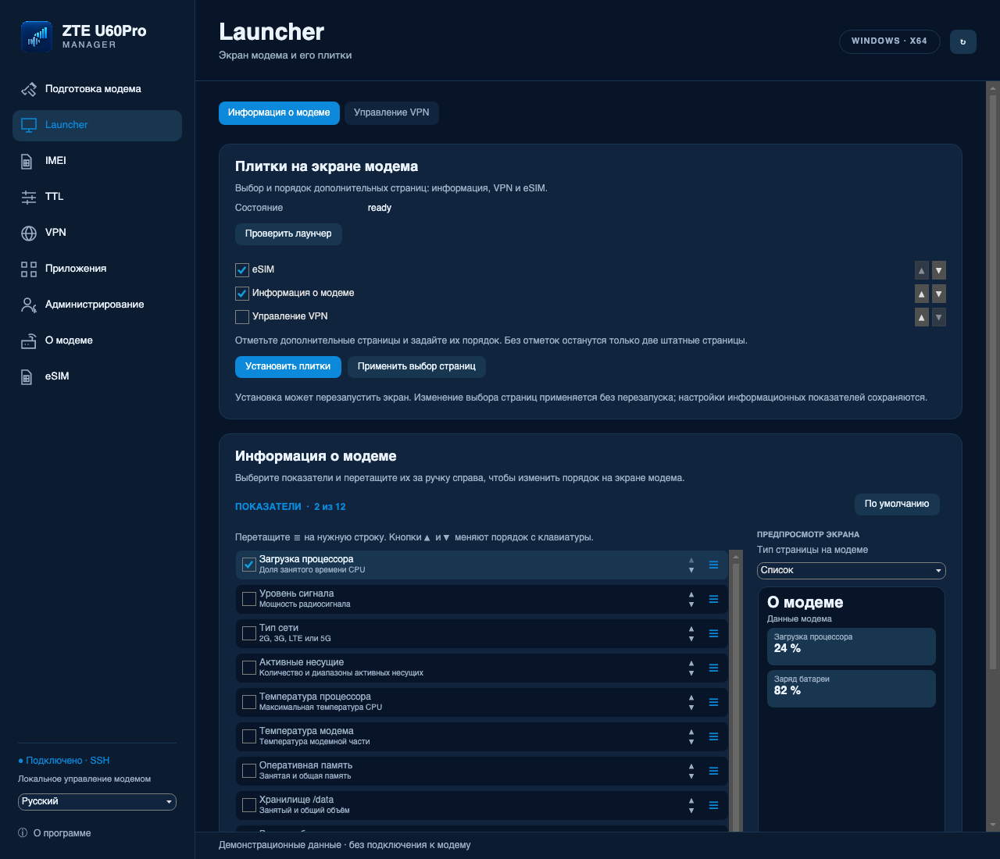
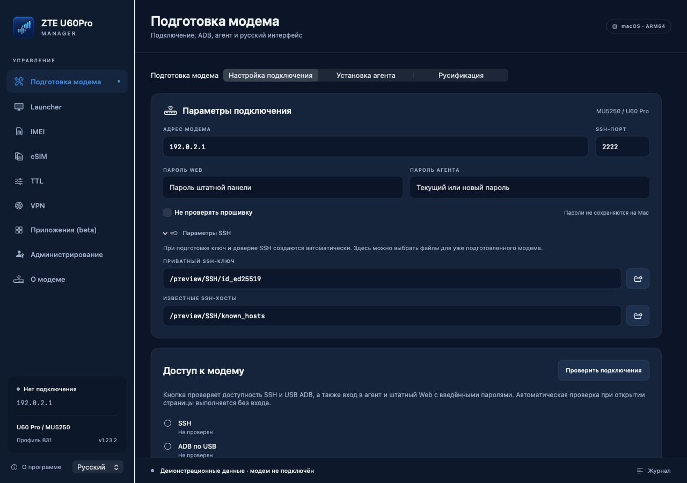
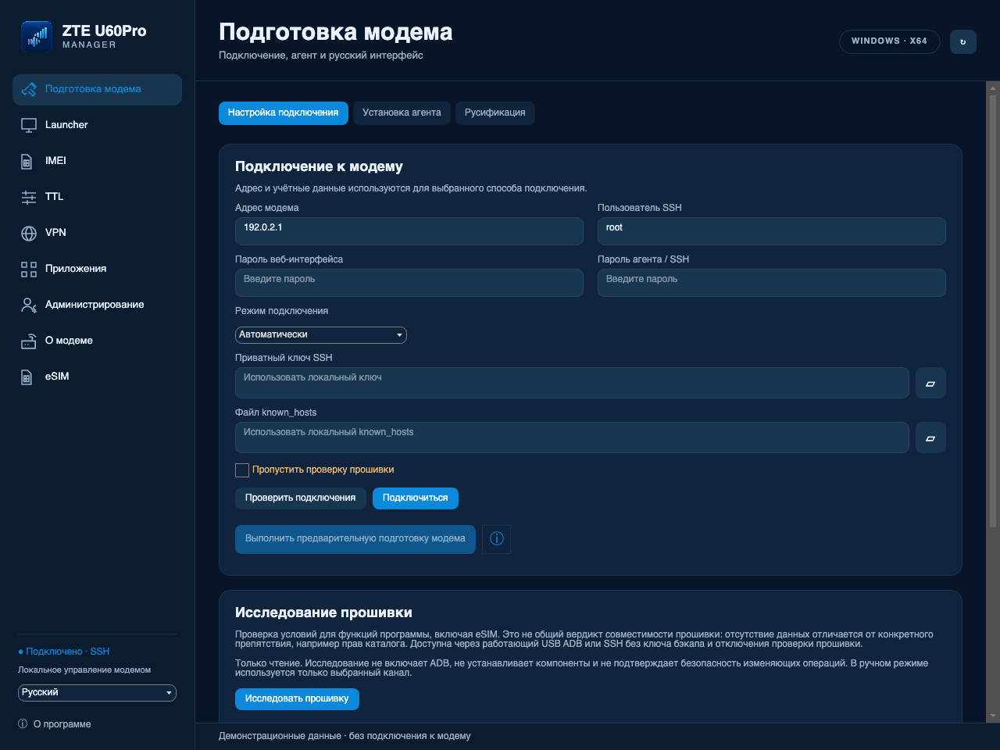

# ZTE U60Pro Manager — приложение и агент

[English](README.md) · **Русский**

Управление **ZTE U60 Pro / MU5250**: подготовка доступа, резервные копии, IMEI, TTL,
русский интерфейс экрана, VPN через отдельный Wi-Fi, физическая eUICC и диагностика.

Версия **1.27.1** (macOS build **68**, Windows FileVersion **1.27.1.0**),
агент **2.9.0-esim.15**, контроллер VPN **1.5.0**.
[Скачать macOS ARM64](https://github.com/SadykovIV/ZTE_U60Pro/releases/download/v1.27.1/ZTE-U60Pro-Manager-1.27.1-macOS-arm64.zip) ·
[Скачать Windows x64](https://github.com/SadykovIV/ZTE_U60Pro/releases/download/v1.27.1/ZTE-U60Pro-Manager-1.27.1-Windows-x64-portable.zip) ·
[Выпуск и контрольные суммы](https://github.com/SadykovIV/ZTE_U60Pro/releases/tag/v1.27.1).

## Исправления в 1.27.1

Исправлено чтение физических 9eSIM, отвечающих `61xx` после SELECT.
Программа дочитывает ответ в своём канале; ошибки чтения больше не выдаются
за ошибки его закрытия. Чтение карты и профилей проверено на модеме B31.

[Изменения и результаты проверок](docs/RELEASE-1.27.1.md#русский).

## Изменения, добавленные в 1.27

- Подготовка модема и установка комплектного агента используют одну автоматическую
  замену агента, SSH и веб-панели. Отдельных галочек очистки и принудительной
  установки больше нет. Настроенный SSH используется без повторного USB bootstrap.
- Старые исполняемые файлы и незавершённые журналы сохраняются перед заменой;
  неизвестные старые скрипты не выполняются. Профили VPN, ключи и настройки
  дополнительных компонентов сохраняются.
- Повтор после обрыва проверяет сохранённую стадию. Ошибка установки панели
  не запускает заново уже подтверждённую замену основных файлов.
- Прошивка определяется автоматически, требования проверяются каждой функцией.
  Для известной B04 без `modem.b16` добавлены измеряемые пути IMEI и переключения
  физической eUICC. Для неподдерживаемых компонентов есть сбор данных в диагностике.

[Изменения и границы проверки](docs/RELEASE-1.27.md#русский) ·
[Совместимость функций и прошивок](docs/FIRMWARE-COMPATIBILITY.md).

## Возможности, добавленные в 1.26

- IKEv2 на штатном strongSwan, EAP-MSCHAPv2 и проверка сертификата сервера.
  Приватные IPv4-сети и DNS профиля идут через VPN, публичные IPv4 — через LTE.
  Учётные данные вводятся в агенте или программе, push подтверждается на телефоне.
- Переключатель VPN Wi-Fi управляет выбранным подключением. Повторное включение
  сохраняет действующее соединение; включённые гостевые интерфейсы автоматически
  восстанавливаются после проверок готовности сети.
- На экране модема статус и переключатель занимают одну строку, профили листаются
  вертикально. Для неподдерживаемых эмодзи используются читаемые обозначения.
  Обновление подписок остаётся в агенте и программах.
- Подготовка принимает известные проверенные файлы запуска с обычными защищёнными
  правами и различает блокировки восстановления и недоступное состояние установщика.
  Неизвестный формат скрипта и непроверенная незавершённая операция остаются блокирующими.
- Веб-панель показывает версию прошивки ZTE отдельно от версии ядра Linux.

[Изменения и границы проверки](docs/RELEASE-1.26.md#русский) · [Настройка IKEv2](docs/IKEV2.md).

Живые проверки VPN выполнены на **CN_ZTE_MU5250V1.0.0B31 / BD_CNMU5250V1.0.0B31**.
Аппаратные проверки B28/B04, запуск на Windows и повторная подготовка на устройствах
из присланных отчётов ещё не выполнены. Журналы подтверждают сбои подготовки,
но не общую несовместимость прошивок.
[Зависимости операций](docs/OPERATION-DEPENDENCIES.md) ·
[Сбор данных для адаптации](docs/FIRMWARE-ADAPTATION-DATA.md).

## Предыдущие улучшения подготовки

- Быстрое управление по SSH: два коротких запроса при подключении; агент, VPN, экран и другие компоненты проверяются по запросу.
- Подготовка по фактическим возможностям устройства: исправлены старые ответы ADB и передача длинных команд; каждая операция проверяет необходимые ей компоненты.
- Восстановление служб VPN и дополнительных страниц после сброса, обработка ошибок VPN на экране модема и подробные отказы русификации. Независимые действия не блокируются чужим журналом подготовки или IMEI.
- Обычная SIM и физическая eUICC различаются по проверенному результату чтения карты; ошибка сама по себе не означает обычную SIM. Проверки остаются на отдельной странице eSIM; встроенная eSIM ZTE не поддерживается.
- Диагностика собрана в подготовке; профиль и необходимые проверки определяются автоматически.

## Обзор

В проекте приложения для двух платформ и самостоятельный агент:

| Компонент | Где работает | Для чего нужен |
| --- | --- | --- |
| **ZTE U60Pro Manager** | Mac с Apple Silicon, macOS 13+ | Подготовка модема, установка и обновление компонентов, IMEI, TTL, бэкапы, eSIM и диагностика |
| **ZTE U60Pro Manager Windows** | Windows x64 | Самодостаточный portable-комплект: подготовка SSH через ADB, управление по SSH, Launcher, VPN, приложения, Terminal, IMEI, eSIM и резервные копии |
| **ZTE Agent** | На самом модеме, Linux ARM64 | Веб-панель RU/EN, состояние модема, сеть, выбор и импорт VPN-профилей; управление физической eUICC; для загрузки профиля нужен интернет модема |

### Проверенная система

| Параметр | Проверенное значение |
| --- | --- |
| Модем | **ZTE U60 Pro / MU5250** |
| Firmware | **CN_ZTE_MU5250V1.0.0B31** |
| Inner firmware | **BD_CNMU5250V1.0.0B31** |
| Платформа модема | Linux ARM64 |
| Физическая eUICC | Ранее проверена съёмная **9eSIM V0** в SIM-слоте; встроенная eSIM ZTE не поддерживается |

В аудите **1.25** на этой B31 проверены обновление компонентов, доступ к
веб-панели, применение и возврат настроек TTL, включение/выключение VPN, порядок
страниц Launcher и русификация. AWG 2/3.1 передали HTTPS через локальный SOCKS
ядра; подписки обновились с сохранением активного выбора. Проверены чтение и
бэкап IMEI, копии конфигурации, модемных разделов и `/data`. Все 15 операций
чтения/проверки состояния завершились успешно; у двух исходящих пакетов TTL 64.
После обычной перезагрузки проверены SSH и выключение ADB. После исправления
запуска VPN ещё две перезагрузки сохранили включённое и выключенное состояние
Wi-Fi, прежний профиль, работу ядра и сети, состояние IPA для текущей загрузки,
правила firewall и HTTPS через локальный прокси.
Итоговый каталог с AWG 2/3.1 и тремя подписками оставлен на модеме; выбранный
пользователем активный профиль сохранён. Модель Launcher прочитала все 72
профиля. **14 октября 2026 года** владелец подтвердил интернет на телефоне через
Wi-Fi с VPN при выключенных мобильных данных, отображение профилей AWG/подписок
на экране модема и исчезновение прежней ошибки VPN в агенте.

Этим не подтверждены скорость, работа каждого импортированного профиля, изменение входящего TTL, свежая
подготовка после заводского сброса, запись IMEI, восстановление полного образа
или запись профилей eUICC в этом аудите. Аппаратная проверка B28/B04 и запуск
на нативной Windows не выполнены.
Диагностический архив отдаёт приоритет основным журналам; большая старая история
может войти частично, с перечислением пропусков в архиве.
[Полный объём проверки](docs/RELEASE-1.25.md#проверка-и-ограничения).

**[Скачать программу и агент](https://github.com/SadykovIV/ZTE_U60Pro/releases/latest)** ·
[Описание программы](docs/APPLICATION.md) · [Описание агента](docs/AGENT.md) ·
[Сборка из исходников](docs/BUILD.md)

Интерфейс доступен на русском и английском. Приложение разработано при поддержке
экспертного подразделения [uFactor](https://usergate.com/ufactor) компании [UserGate](https://usergate.com).

## Скриншоты

### Диагностика

В текущем интерфейсе **«Подготовка модема → Диагностика»** — одна страница
проверки устройства, исследования прошивки и экспорта. Способы подключения
собраны в компактном раскрывающемся блоке вкладки **«Подключение»**.
Журнал остаётся в администрировании, диагностические утилиты — в приложениях.

Интерфейс предыдущего кандидата **macOS build 42 / Windows 1.24.4.1**:

| macOS · 1.24.4 build 42 | Windows UI · 1.24.4.1 |
| --- | --- |
|  |  |
|  |  |

Снимки созданы интерфейсом приложения с отдельными тестовыми данными. Windows UI
проверен на macOS; снимки не подтверждают запуск на Windows. [RU/EN и источники
снимков](docs/images/README.md#подключение-и-единая-диагностика-1244-build-42).
Снимки предыдущего **build 41** с тремя группами сохранены [как история](docs/images/README.md#диагностика-1244).

Ниже сохранены иллюстрации eSIM, Launcher и подключения из 1.23.2.

### eSIM

Установка из QR или LPA-строки, отдельные поля **SM-DP+ Address** и **Activation code**, список профилей и выбор активного. Нужна **съёмная физическая eUICC в SIM-слоте**; проверена 9eSIM V0. Встроенная eSIM ZTE этим выпуском не поддерживается.

| macOS | Windows UI |
| --- | --- |
|  |  |

### Страницы экрана модема

Галочками выбираются «Информация», VPN и eSIM; стрелки задают порядок страниц.

| macOS | Windows UI |
| --- | --- |
|  |  |

Подключение и подготовка модема

| macOS | Windows UI |
| --- | --- |
|  |  |

Снимки настоящего интерфейса с демонстрационными данными. Windows UI отрисован через Avalonia на macOS; это не проверка запуска в Windows. [Все скриншоты RU/EN и сведения об их происхождении](docs/images/README.md).

## Требования к модему

### Источники и благодарности — прочитайте до установки

Разработка опирается на следующие проекты и материалы по ZTE. Ссылки на источники
не означают поддержку этой сборки их авторами.

1. **[jesther-ai/open-u60-pro](https://github.com/jesther-ai/open-u60-pro)** — исходное исследование U60 Pro, API, доступ к устройству и основа агента. Автор: **Jesther Silvestre**. Обсуждение ключа резервного копирования: **[issue #8](https://github.com/jesther-ai/open-u60-pro/issues/8)**.
2. **[dklasens/MU5250-OpenUI](https://github.com/dklasens/MU5250-OpenUI)** — основа Rust-агента, веб-панели, безопасного запуска процессов и процедуры подготовки устройства. Автор: **David Klasens**. Использована база **[v2.4](https://github.com/dklasens/MU5250-OpenUI/releases/tag/v2.4)**, commit `fabaf8b53678dc50e3c3fa2fa3de8b51061967cc`; протокол ADB-подготовки сверялся с **[zunlock.py](https://github.com/dklasens/MU5250-OpenUI/blob/v2.4/scripts/zunlock.py)**. MIT-уведомления сохранены.
3. **[4PDA: ZTE U60 Pro MU5250 5G](https://4pda.to/forum/index.php?showtopic=1108605)** — тематическое обсуждение модема. Конкретный рецепт установки SSClash из этой темы не подтверждён; наш установщик не выдаётся за копию форумного решения.
4. **[OpenWrt 23.05.4](https://downloads.openwrt.org/releases/23.05.4/)** — пакеты Dropbear и uhttpd, документация UCI/ubus и сетевых служб. [Полный список зависимостей, версий и лицензий](THIRD_PARTY_NOTICES.md).
5. Для VPN используется **[MetaCubeX/Mihomo v1.19.31](https://github.com/MetaCubeX/mihomo/tree/v1.19.31)**. **[SSClash-Go](https://github.com/zerolabnet/SSClash-Go)** — отдельное необязательное приложение; пока не входит в проверенный каталог, его исполняемый файл не включён в публикацию.
6. Для eSIM используется **[estkme-group/lpac v2.3.0](https://github.com/estkme-group/lpac/tree/c2fcf5e4b21c712d54e35a11da2ad9ad134fb821)** с закреплёнными исправлениями stdio. [Сборка компонентов eSIM](third_party/ESIM-SOURCES.md), [лицензии](THIRD_PARTY_NOTICES.md).

Формат NV550/EFS, ограничения прошивки B31, русификация и интеграция страниц
экрана дополнительно исследованы на собственном устройстве. Использовался также
предоставленный локальный инструмент «ZTE U60 Pro (MU5250) — Professional Device
Manager» как справочный материал по API; его автор и первичная ссылка не были
установлены, поэтому его код и архив не распространяются здесь. Прошивка ZTE,
полные исполняемые файлы штатного интерфейса и дампы устройства не публикуются.

### Проверенная конфигурация

- **ZTE U60 Pro / MU5250**, прошивка **CN_ZTE_MU5250V1.0.0B31**.
- Linux ARM64 на модеме; дополнительные пакеты используют базу OpenWrt **23.05.4**, `aarch64_cortex-a53`. Это не замена прошивки на OpenWrt.
- Доступ к локальной сети модема; стандартный адрес — **192.168.0.1**.
- Для новой установки SSH: root USB ADB и пароль нового агента. Для включения ADB через штатный Web нужен его пароль. Уже работающий SSH используется без установки агента. Программа последовательно проверяет готовый SSH, root USB ADB, штатный USB debug через Web и способ через бэкап. Известный платформенный ключ проверяется на свежем архиве независимо от имени прошивки; восстановление допускается только после проверки архива и штатного загрузочного блока USB. Поле **backup-key suffix** — необязательная ручная замена; неверное введённое значение останавливает подготовку. Пароли владельца и доверие SSH создаются для его устройства.
- Стабильное питание и свободное место в `/data`; требуемый объём проверяется перед установкой.
- VPN использует гостевые интерфейсы обоих диапазонов. Mesh и конфликтующий сторонний прокси должны быть выключены; программный путь обработки пакетов нужен для TTL/VPN.

Для ранних и других прошивок MU5250 используется та же последовательность подготовки. Доступный root USB ADB позволяет проверить установку SSH в фактической Linux ARM64-среде. Совместимость IMEI, радиоцикла и экранного расширения проверяется отдельно; успешная подготовка не подтверждает эти функции.

**Изменения модема выполняются на ваш страх и риск. Возможны потеря данных и
повреждение устройства.** Полная аппаратная проверка других прошивок пока не завершена.
Галочка отключения общей проверки прошивки есть в программе, сопровождается
предупреждением и сбрасывается после её закрытия. Проверки структуры NV/EFS,
резервных копий и точной совместимости экранного расширения остаются включёнными.

## Проверка устройства перед установкой

После подключения по SSH откройте **«Подготовка модема → Диагностика → Данные
для адаптации прошивки»**. В один ZIP входят свежее исследование и доступные
файлы компонентов. Подробные проверки, пропуски и причины ошибок находятся
в архиве. Неизвестная прошивка не запрещает чтение; каждая операция записи
проверяет собственные требования. Постоянный агент для исследования не нужен.

Если SSH ещё нет, отдельная подготовка доступа использует root USB ADB и
внутреннее исследование устройства перед установкой. Для этого этапа сохранены
проверки выбранного USB-устройства и идентичности; обычная диагностика их
не обходит.

Установка доступа проверяется заново по текущему устройству. При уже работающем
root USB ADB можно подготовить SSH и агент без штатного Web API.
Этот установщик поддерживает измеренную среду Linux ARM64 с проверенной
структурой `/data`, Dropbear и запуском через procd/rc.local. Другие среды
остаются доступными для исследования и требуют своего установщика.
Исследование прошивки выполняет программа по SSH. Агент предоставляет
информацию и управление для веб-панели и страниц модема. Каждая операция
проверяет необходимые ей компоненты; общего диагностического режима нет.
Совместимость IMEI, eSIM, Launcher, VPN и восстановления проверяется отдельно. [Контракт и границы проверки](docs/DEVICE-DISCOVERY-CONTRACT.md).

Общие диагностические действия собраны на одной странице **«Диагностика»**
без дополнительных вкладок. Проверки подключений и переключатель ADB находятся
в **«Подключение → Доступные способы подключения»**.
В разделе «О модеме» остаются информация и память. Журнал действий остаётся
в «Администрировании» вместе с доступом и резервными копиями; общая кнопка
журнала ведёт туда же. Диагностические утилиты остаются в «Приложениях».
Проверка карты eSIM и действия VPN остаются на своих страницах.

**«Логи и журналы»** сохраняет подготовку, подключения и операции программы.
При готовом SSH добавляются доступные журналы модема. Без SSH сохраняются
локальные данные и причина пропуска. **«Данные для адаптации прошивки»**
собирает исследование и файлы компонентов. Постоянный журнал Windows ведётся
с 1.24.4; закрытые сеансы более ранних версий восстановить нельзя.
[Состав данных для адаптации](docs/FIRMWARE-ADAPTATION-DATA.md).

### Переключатель USB ADB

**«Включить ADB»** читает и меняет состояние через SSH на измеренных
USB-конфигурациях B31/B28/B04. Изменяются ссылка функции ADB и точная строка
автозапуска ADB, добавленная программой; `rc.local` сохраняется в резервную
копию, остальные строки не меняются. Другие USB-функции проверяются до и после
операции. USB-соединение, включая сеть, может кратко прерваться. Без
подтверждения через SSH модем пытается восстановить USB и автозапуск через
60 секунд. Неопределённый результат блокирует повторную запись.
Есть отдельная кнопка **«Выключить ADB и автозапуск»**. Подготовка пытается
выполнить этот шаг только после проверки SSH. Неизвестное состояние показано
отдельно от выключенного; другие USB-конфигурации требуют адаптации.

## Быстрый старт

1. Скачайте ZIP для своей ОС из Releases. На Mac откройте `.app`; на Windows распакуйте весь архив и запустите `ZTE U60Pro Manager.exe`, сохранив папку `Resources` рядом. .NET отдельно не требуется, для USB ADB может понадобиться драйвер модема.
2. Во вкладке **«Подготовка модема → Подключение»** подключитесь по SSH. Если SSH ещё не настроен, используйте отдельную подготовку: сначала работающий root USB ADB, а при его отсутствии — штатный USB debug через Web, затем проверенный способ через бэкап. Пароль Web нужен для этих Web-способов; ручной ключ бэкапа необязателен. SSH-ключ создаётся на компьютере; привязка устройства проверяется через USB. При готовом SSH повторная подготовка не нужна. Все обычные операции программы выполняются по SSH; кнопки Web и агента открывают браузер. Для адаптации прошивки после подключения используйте **«Диагностика → Данные для адаптации прошивки»**. [Методы, команды и продолжение после обрыва](docs/ADB-PREPARATION.md).
3. Сохраните резервную копию перед изменениями. Для IMEI обязательный бэкап делается автоматически.
4. Установите нужные компоненты. В разделе **«VPN»** можно установить компоненты и управлять профилями прямо из программы или через веб-панель агента. Страницы дисплея устанавливаются и настраиваются в **Launcher**. В проверенном каталоге доступны htop и экспериментальный opkg; список обновляется отдельно с GitHub. Terminal открывает SSH-сеанс автоматически. Уже установленные приложения вне каталога доступны для удаления.
5. Для eSIM вставьте физическую eUICC, выберите физический SIM-слот и запросите профили в разделе **eSIM**. Загрузка через программу использует интернет компьютера, через веб-панель — интернет модема. [Подробности и ограничения](docs/ESIM-DESKTOP.md).
6. Откройте агент через кнопку программы или `http://192.168.0.1:8080`. API находится на порту **9090**. Пароль агента задаётся при подготовке; общего пароля в сборке нет.

После сбоя или заводского сброса используйте обычную кнопку подготовки и введите
пароль агента в существующих параметрах подготовки. Программа сама сохраняет
старые файлы, заменяет агент и SSH и устанавливает текущую панель. При обновлении
комплектного агента проверяемые параметры доступа переносятся на самом модеме;
пароль не считывается на компьютер. Если восстановить его как данные нельзя,
нужно заново ввести пароль в параметрах подготовки. Профили VPN, штатные настройки,
IMEI и SIM/eSIM не сбрасываются. Старые резервные копии сохраняются. Для незавершённой
операции нажмите ту же кнопку: сначала будет проверен её результат, затем продолжена
недостающая стадия. Активная запись NV/FOTA или другой работающий установщик
должны завершиться до новой замены.

Программа подписана **ad-hoc**, не нотарифицирована Apple. Если macOS блокирует
запуск, используйте «Открыть»/«Конфиденциальность и безопасность → Всё равно
открыть» для проверенного скачанного файла. Не отключайте Gatekeeper целиком.
Windows EXE не подписан сертификатом; контрольные суммы находятся в `SHA256SUMS`.

## Что находится в репозитории

- `MacIMEI/` — исходники SwiftUI, модемные C-помощники, установщики и тесты.
- `Windows_x64/` — исходники Avalonia/.NET, ресурсы, тесты и скрипты Windows-сборки.
- `ModemAgent/` — Rust-агент, VPN-контроллер, React-панель и расширение лаунчера.
- `Catalog/` — подписанный список проверенных приложений; `Branding/` — значок и сведения о его создании.
- `docs/` — использование и сборка; `tools/` — подготовка зависимостей, выпуск и аудит.

Персональных SSH-ключей, логинов владельца, резервных копий, рабочих VPN-профилей,
серверов и конфигурации конкретного модема здесь нет. Тестовые значения и
`example.com` — синтетические; никакие тестовые профили не устанавливаются.
Стандартные системные имена вроде `root` сохранены там, где они нужны протоколу.
Имена авторов и адреса исходных проектов сохранены для корректной атрибуции.

## Лицензии и границы проверки

Собственный код и производные части MIT-проектов — [MIT](LICENSE), с сохранением
уведомлений upstream. Отдельные зависимости имеют свои лицензии, включая GPLv3
у Mihomo, AGPLv3 у lpac и LGPLv2.1 у libeuicc; см. [THIRD_PARTY_NOTICES.md](THIRD_PARTY_NOTICES.md).

Функции базовой версии проверялись на B31. Публичная сборка пересобирается после
обезличивания и проверяется локальными тестами; изменения имени сети и способа
получения ключа/SSClash не считаются новой проверкой на всех версиях прошивки.
Диагностический ZIP предназначен для изучения совместимости, но его следует
просмотреть перед отправкой: автоматическая очистка не распознаёт любые
неизвестные личные данные.

Windows проверен сборкой, синтетическими тестами и тестом интерфейса Avalonia; запуск на физической Windows и установка на модем из Windows пока не проверены. Windows умеет создавать и проверять полные образы eMMC, но не восстанавливать их. macOS-восстановление требует отдельной среды восстановления; образ такой среды не входит в релиз. Полные снимки работающей системы не атомарны и не включают RPMB/OTP.
